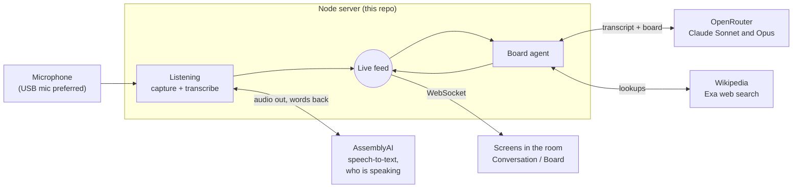
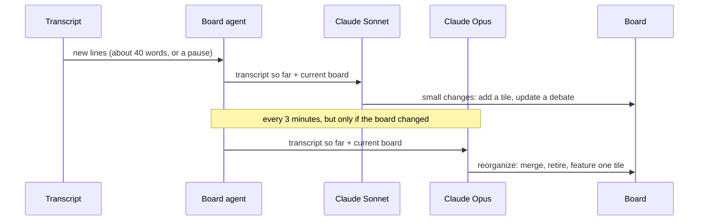

# Speaker Board

A screen for a conversation happening in a room. It listens, writes down who said what, and builds a live board that helps anyone glancing at it follow along: who and what is being discussed, the facts behind it, and where each person stands.

The original idea comes from [this speaker board](https://rossi.lol/wall-piece.html).

It has two views:

- **Conversation:** the live transcript, color-coded by speaker, with each person's talk time and an audio-reactive visual in the background.
- **Board:** tiles assembled by an AI agent as the conversation goes: people (with photos), background facts, the debate of the moment, timelines, memorable quotes, and charts.

## How it works



In plain terms:

1. **The server listens.** It records from the microphone and streams the audio to AssemblyAI, which sends back words and a guess at who said each one (speaker A, B, C…).
2. **Words become lines.** The server groups those words into lines per speaker and works out simple stats like talk time.
3. **Everything goes out on a live feed.** Any number of browser screens connect to it and update instantly. A screen that reconnects catches up straight away.
4. **The agent keeps the board current.** It reads the transcript, looks things up, and adds, updates or removes tiles. The screens show the result.

The browser never touches the microphone or any API key; it only displays what the server sends.

## The parts

### 1. Listening (`server/ingest/`)

- **Microphone capture:** records 16 kHz audio on the server. Prefers any microphone with "USB" in its name and falls back to the system default.
- **Transcription:** streams audio to AssemblyAI's real-time API with speaker separation turned on, and reconnects on its own if the connection drops.
- **Line building (segmenter):** turns a stream of words into readable lines. A new line starts when the speaker changes or after a short pause. Words AssemblyAI can't attribute yet are shown in a neutral grey line instead of being dropped.
- **Spectrum:** computes the frequency spectrum the background visual draws.
- **Mock mode:** replays a scripted three-person conversation (`server/mock/script.ts`), so everything works without a microphone or API keys.

### 2. The live feed (`server/bus.ts`)

A single WebSocket channel that every screen connects to. The server publishes small events (new or updated lines, talk-time stats, audio levels, the board) and screens apply them. The server keeps the recent transcript and the current board so a new or reconnecting screen gets the full picture on arrival.

### 3. The board agent (`server/board/`)

The agent works in two rhythms:



- **Updates** (Claude Sonnet, frequent) add what's new and adjust positions as people change their minds.
- **Editor passes** (Claude Opus, every few minutes) step back and tidy the whole board: merge overlapping tiles, retire ones the conversation has moved past, and pick one tile to feature at the top.

To do its work the agent has a small set of tools: look things up on Wikipedia (free), search the web through Exa, and add, re-rank or remove tiles.

**Guardrails.** The board is shown publicly, so the server enforces these rather than trusting the model:

- **No invented links or images.** The model never writes an image URL; it names a Wikipedia article or a search result, and the server attaches the picture. Cited sources must be pages a search or lookup actually returned.
- **Only real speakers.** Tiles can only refer to speakers who appear in the transcript.
- **Bounded:** at most 12 tiles and one featured tile; at most 3 web searches per update.
- **No needless redraws.** Rewriting a tile with identical content is refused.
- **Fails safe.** A bad API key or empty account stops the agent after one attempt and the board says why; a failed editor pass never blocks regular updates.

All model calls go through OpenRouter, so the models can be swapped in `.env`. Each update's cost is printed in the server log.

### 4. The screens (`src/client/`)

A React app (Vite, Tailwind, shadcn/ui) with the two views:

- **Conversation:** transcript rows that stream in live and settle when the speaker pauses, a talk-time panel, and a spectrum visual ported from [the original speaker board](https://rossi.lol/wall-piece.html) (blue dots mirrored around the center that pulse with the room's sound).
- **Board:** the tiles below, newest first, with the featured tile pinned full-width at the top and background tiles shown compact.

| Tile | Shows |
|---|---|
| **Where they stand** | The debate of the moment: each speaker's position, their main points and a quote, an agreement meter (split / leaning / in agreement), the tone (lively, heated), and stance changes such as "undecided → mixed". |
| **Person** | Who someone being discussed is, with a photo from Wikipedia. |
| **Context** | A fact, place, event or idea the conversation depends on. |
| **Timeline** | Dated events the conversation refers to. |
| **Quote** | A memorable line from the room, verbatim. |
| **By the numbers** | A simple bar chart, sourced. |

Every tile built from the web shows its sources.

## Getting started

Requirements: Node 20.12 or later. Built and tested on macOS.

```bash
npm install
cp .env.example .env
npm run dev
```

Open http://localhost:5173. With the default `.env` it runs in mock mode: a scripted conversation, no microphone, no keys. Add `--board=mock` to also see a sample board without an OpenRouter key:

```bash
npm run dev -- --board=mock
```

To run it for real, fill in `.env`:

| Setting | What it's for |
|---|---|
| `INGEST=assemblyai` and `ASSEMBLYAI_API_KEY` | Live transcription from the microphone |
| `BOARD=agent` and `OPENROUTER_API_KEY` | The board agent |
| `EXA_API_KEY` (optional) | Web search through Exa; without it, OpenRouter's built-in search is used |

The first time the server opens the microphone, macOS asks for permission for the app the server runs in (Terminal, iTerm, Cursor…); see [Troubleshooting](#troubleshooting).

### Controls

| | |
|---|---|
| `npm run dev -- --speakers=3` | Tell transcription how many people are talking (1–10) |
| `npm run dev -- --board=agent\|mock\|off` | Choose what fills the board |
| `1` / `2` | Switch between Conversation and Board |
| `f` | Fullscreen |
| `?view=board` | Open straight to the board (useful for a dedicated screen) |
| `?max=40` | How many transcript lines the Conversation view keeps |

### Running it as an installation

```bash
npm run build
npm run start            # serves the app and the live feed on http://localhost:8787
open -a "Brave Browser" --args --kiosk "http://localhost:8787/?view=board"
```

Several screens can open the same URL (one on `?view=board`, one on the conversation) and all stay in sync. Keep the machine from sleeping (System Settings → Energy, or run under `caffeinate`), since sleep cuts off transcription and the agent mid-request.

## Configuration

All settings live in `.env` (see `.env.example`). The ones you're most likely to change:

| Setting | Default | Meaning |
|---|---|---|
| `INGEST` | `mock` | `assemblyai` for the real microphone, `mock` for the scripted conversation |
| `MAX_SPEAKERS` | not set | Upper bound on the number of speakers (1–10) |
| `AUDIO_DEVICE_MATCH` | `usb` | Part of the microphone name to prefer; the startup log lists every device |
| `AUDIO_DEVICE_INDEX` | not set | Pin a specific microphone by its number in that list |
| `COMMIT_DEBOUNCE_MS` | `900` | Pause (ms) that ends a transcript line |
| `BOARD` | `off` | `agent`, `mock` or `off` |
| `BOARD_MODEL` | `anthropic/claude-sonnet-5.5` | Model for frequent updates |
| `BOARD_EDITOR_MODEL` | `anthropic/claude-opus-5.5` | Model for the periodic reorganize pass |
| `BOARD_INTERVAL_S` | `30` | Minimum seconds between agent runs |
| `BOARD_EDITOR_INTERVAL_S` | `180` | Seconds between editor passes |
| `DEBUG_LOG_FILE` | not set | Write a detailed log (transcription, agent calls, costs) to this file |

## Troubleshooting

- **Nothing gets transcribed.** On macOS, microphone permission belongs to the app that runs the server, not to the browser. Check System Settings → Privacy & Security → Microphone, then fully quit and reopen that app. The server prints the microphone it opened (`mic: …`) and warns if it hears silence for 10 seconds.
- **The USB mic isn't used.** Plug it in before starting; the startup log shows which device was picked and why.
- **The board says it's off.** The message on the board says why: usually a missing or rejected `OPENROUTER_API_KEY`.
- **Speaker numbers changed after reloading a screen.** Screens number speakers in the order they first see them, so a reload late in a long session can renumber them. Keep display screens open from the start.

## Privacy and cost

- **Where the data goes:** audio goes to AssemblyAI, transcript text and the board to OpenRouter (and on to the model provider), search queries to Exa, and article lookups to Wikipedia.
- **What stays on the machine:** with `DEBUG_LOG_FILE` set, full transcripts are written to `logs/`, which git ignores.
- **Tell the room:** if the board runs in a public space, let people know they're being transcribed.
- **Cost:** an update is usually a few cents and an editor pass a little more. A quiet room costs nothing, because the agent only runs on new speech.

## Project layout

```
server/
  index.ts          startup: wires listening, the live feed and the board together
  args.ts           launch flags (--speakers, --board)
  bus.ts            the live feed every screen connects to
  ingest/           listening: microphone, AssemblyAI, line building, spectrum, mock
  analysis/         talk-time stats
  board/            the board agent: models, tools, Wikipedia, Exa, guardrails, mock board
  mock/             the scripted conversation used in mock mode
src/
  shared/           what server and screens agree on: events and tile types
  client/           the React app: views, tiles, live state, background visual
  components/ui/    shadcn/ui building blocks
scripts/
  analyze-log.mts   replays a debug log through the line builder, to check how speech was split
```
